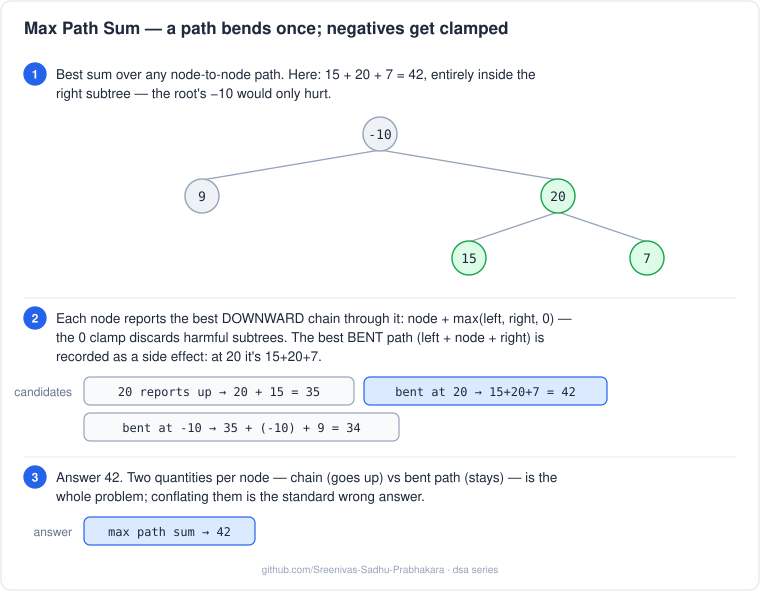

# Maximum Path Sum

> Striver SDE Sheet 124 · Day 19 Binary Tree III — per node: bend using both children's clamped gains for the answer, but pass only one arm upward. Go, stdlib only, tested.

## Problem

The maximum sum over all paths in a binary tree, where a path connects any node to any node through parent-child edges and must contain at least one node — values may be negative, so "take everything" is wrong.

## Approach

Diameter's grown-up sibling. Each node plays two roles that must not be conflated: as the *bend* of a complete path, it may take both children's contributions (`val + leftGain + rightGain` → candidate answer); as a *segment* of its parent's path, it may extend only one arm (`val + max(gain)` → return value). Clamping each child's gain at zero (`max(gain, 0)`) encodes "a negative subtree is simply not taken" without any casework. Seeding the best with the root's value keeps all-negative trees honest — the empty path isn't allowed, so the answer there is the largest single node.

**Complexity:** O(n) time, O(h) recursion.

## Visual walkthrough

Read the picture top to bottom — each numbered frame is one moment of the algorithm
running on this repo's test example.

## Run

    go test ./...   # verify
    go run .        # demo

---

One of 191 repos solving Striver's SDE Sheet in Go — stdlib only, one problem per repo, every solution tested. Browse the set: [`dsa-*` repos](https://github.com/Sreenivas-Sadhu-Prabhakara?tab=repositories&q=dsa-&type=source).
